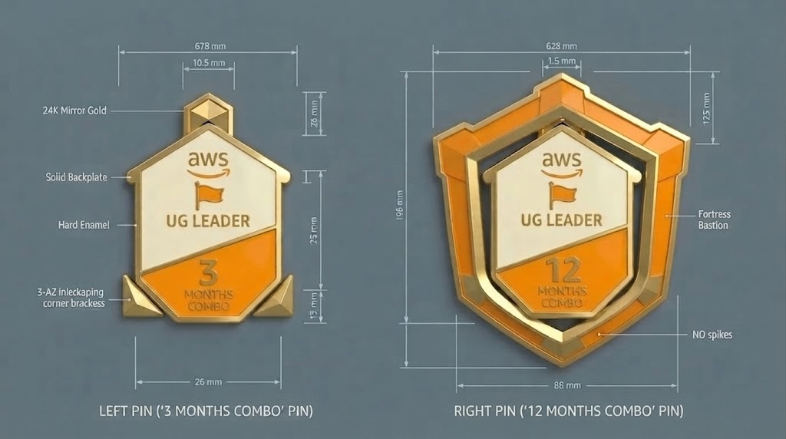

# 方案 09：Multi-AZ高可用堡垒 (Multi-AZ Resilient Shield)

## 一、 方案设计理念与三级进阶演化

* **🌟 文化属性**：
* **💡 超级核心 Idea**：AWS Multi-AZ 多可用区容灾架构，象征领袖稳如泰山、永不下线（99.999% SLA）的担当。
* **🔒 母体同源铁律**：1M、3M、12M 三款中心小房子主体尺寸（宽 28.0mm × 高 34.0mm）、象牙白上半部、AWS 活力橙下半部、24K 镀金立体浮雕  Logo、旗帜图标与  排版 **100% 绝对一致**。
* **📈 阶梯演进路径**：
  * **【1 Month 全社区统一入门款】**：统一纯净小房子母体（屋顶零外展装饰，标称高 34.0mm，浮雕 ）；
  * **【3 Months Combo 进阶款】**：顶部与底角带有微缩金色 3-AZ 角码 (标称高 34.0mm，浮雕 3 MONTHS COMBO)；
  * **【12 Months Combo 巅峰款】**：对称三向 3-AZ 互锁重装甲堡垒护甲，多层重装甲金盾 (标称高 68.0mm，浮雕 12 MONTHS COMBO)。
* **🚫 100% 实心底托与 0 镂空（Zero Cutouts）**：完全杜绝透光孔洞与镂空网眼，背部采用实心金属底板与大面积平整实心仿珐琅填色，加粗金属棱线（≥ 1.2mm），适宜工厂冲压开模与研磨抛光。

---

## 二、 纯平面实物仿珐琅工程设计对比蓝图

---

## 三、 工艺参数与生产规范

1. **外形尺寸规范**：
   * **1 Month 统一入门款**：宽 28.0mm × 高 34.0mm
   * **3 Months Combo 进阶款**：宽 28.0mm × 高 34.0mm（带微特征）
   * **12 Months Combo 巅峰款**：外径约 58.0mm ~ 68.0mm（一体化连续金属外轮廓，实心无孔）
2. **电镀与材质规范**：
   * 顶部：象牙白硬珐琅（Pantone 7499C）
   * 底部：AWS 活力橙硬珐琅（Pantone 151C）
   * 金属线条与外圈：高光镜面 24K 金色电镀（Polished 24K Gold Plating），主线条凸棱 ≥ 1.2mm
   * 文字：高光镀金浮雕立体字（Raised Gold Relief Text）
3. **背面配件**：双/多刺马针 + 蝴蝶扣/高级卡帽（Dual/Multi Pin Posts & Clutches）
